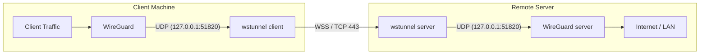

# Wireguard over wstunnel (TCP)

## About The Project

This is a Python application that quickly and easily enables the use of Wireguard over TCP using [wstunnel](https://github.com/erebe/wstunnel). It can run in headless CLI mode or as a lightweight cross-platform system tray app (`--gui`).

## How It Works

WireGuard normally uses UDP, which can be blocked or throttled on restrictive networks. This app wraps WireGuard's UDP packets inside an encrypted WebSocket/TLS (`wss://`) connection over TCP port 443 (or any configured port) via `wstunnel`:



On startup, the app automatically handles the wiring so you don't have to manage routes or configs manually.

Features:

1. **Resolves the server DNS** (also cached in `conf/dns.json`) and passes the resolved IP directly to `wstunnel` along with the matching TLS SNI and HTTP `Host` header, avoiding DNS deadlocks once the VPN is active.
2. **Generates a runtime WireGuard config** in `conf/` that points `Endpoint` to the local `wstunnel` listener and excludes the server's IP from `AllowedIPs` to prevent routing loops.
3. **Starts `wstunnel` before WireGuard** and runs background health checks (tunnel state, ping, and public IP verification) with automatic recovery.
4. **Tears down cleanly on exit** (or via `--clean`) to remove the WireGuard interface and stop `wstunnel`.

## Getting Started

### Prerequisites

This script requires the following software to be installed/downloaded:

- [Python 3](https://www.python.org/downloads/)
- [wstunnel](https://github.com/erebe/wstunnel/releases)
- [Wireguard](https://www.wireguard.com/install/)

## Build

To create a standalone binary using PyInstaller, follow these steps:

1. Download the latest [release](https://github.com/klementng/wireguard-over-wstunnel/releases/) source code or clone the repository.
2. Install build dependencies:

   ```bash
   python -m pip install -r requirements-build.txt
   ```

3. Build the binary for your platform:

   - **macOS:**

     ```bash
     python -m PyInstaller main.py --onefile --hidden-import=pystray._darwin --hidden-import=AppKit
     ```

   - **Windows:**

     ```bash
     python -m PyInstaller main.py --onefile --uac-admin --hide-console hide-late --hidden-import=pystray._win32
     ```

   - **Linux:**

     ```bash
     python -m PyInstaller main.py --onefile --hidden-import=pystray._xorg --hidden-import=pystray._gtk --hidden-import=pystray._appindicator
     ```

4. The output binary will be located in the `dist` directory.

### Installation

#### Using PyInstaller Binaries

1. Download the latest [release](https://github.com/klementng/wireguard-over-wstunnel/releases/) binary.
2. Change permissions (for Linux/macOS systems):

   ```sh
   chmod +x ./main
   ```

3. Edit [config.yml](./config.yml).
4. Start the program (on Windows, double-clicking `main.exe` automatically starts the system tray GUI):

   ```sh
   # CLI mode
   ./main

   # System tray GUI (detached in the background, auto-connecting)
   ./main --gui --detached --auto-connect
   ```

#### Using Source Code

1. Download the latest [release](https://github.com/klementng/wireguard-over-wstunnel/releases/) source code or clone the repository.
2. Install required packages:

   ```sh
   pip install -r requirements.txt
   ```

3. Edit [config.yml](./config.yml).
4. Start the program:

   ```sh
   # CLI mode
   python main.py

   # System tray GUI
   python main.py --gui
   ```

## Command Line Usage

```text
usage: main.py [-h] [--config CONFIG] [--clean] [--gui | --no-gui]
               [--auto-connect] [--detached]

Wireguard over wstunnel

options:
  -h, --help            show this help message and exit
  --config CONFIG, -c CONFIG
                        path to program config
  --clean               clean wireguard tunnels that were not properly stopped
  --gui, --no-gui       start with the system tray GUI (default when
                        double-clicked on Windows)
  --auto-connect        connect automatically when the tray GUI starts
  --detached            detach and run the tray GUI in the background

Run the program with --clean to remove leftover wg-wst-* interfaces.
```

## License

Distributed under the MIT License. See [LICENSE](./LICENSE) for more information.
